# Background jobs waitlist

This is a small background job system for a waitlist signup. `POST /api/waitlist` validates the email, writes a job row, and returns `202`; it does not send email inline. A separate worker claims eligible jobs and sends the confirmation email through Resend.

## Setup

You need a local PostgreSQL database and a Resend API key.

```bash
cp .env.example .env
npm install
npm run prisma:migrate
npm run dev
```

Run the worker in another terminal:

```bash
npm run worker
```

The `.env` variables are:

```text
DATABASE_URL
RESEND_API_KEY
EMAIL_FROM
NEXT_PUBLIC_APP_URL
WORKER_TEST_DELAY_MS
STUCK_JOB_TIMEOUT_MS
STUCK_JOB_SWEEP_INTERVAL_MS
```

## Configuration

Worker configuration lives in `src/config/index.ts`.

| Setting | Default | Purpose |
| --- | ---: | --- |
| Concurrency | `5` | Maximum jobs processed at once |
| Max attempts | `5` | Attempts before a job becomes dead |
| Backoff base | `1000ms` | Base for exponential retry delay |
| Backoff jitter | `250ms` maximum | Random delay added to retries |
| Stuck-job timeout | `2 minutes` | Age at which processing jobs are reclaimed |
| Sweep interval | `30 seconds` | How often the worker sweeps for stuck jobs |
| `WORKER_TEST_DELAY_MS` | `0` | Testing only: hold a claimed job before sending |
| `STUCK_JOB_TIMEOUT_MS` | `120000` | Testing only: override the stuck-job timeout |
| `STUCK_JOB_SWEEP_INTERVAL_MS` | `30000` | Testing only: override the sweep interval |

## Job lifecycle

`pending` jobs are waiting to be claimed. A worker moves an eligible job to `processing`, then sends the confirmation. A successful send moves it to `succeeded`.

If delivery fails, the worker stores the error, increments `attempts`, and moves the job to `failed` with an exponential retry time. `failed` means retries remain. When attempts are exhausted, the job becomes `dead`, records `finishedAt`, and requires human attention. The worker sweep treats a job left in `processing` beyond the timeout as a failed attempt: it resets it to run immediately, or marks it dead when that was the final attempt.

## Design decisions

### Atomic claiming

The claim uses one `UPDATE` whose eligible-row subquery uses `FOR UPDATE SKIP LOCKED`. This atomically changes `pending` or eligible `failed` to `processing`; it does not read a row and then write it later. The alternative was read-then-write claiming, which allows two workers to observe and process the same job.

### Exponential backoff with jitter

Retries use `baseDelayMs * 2^attempts` plus random jitter. The alternative was a fixed delay. Exponential backoff reduces pressure on a failing provider, while jitter prevents many jobs from retrying together in a synchronized burst.

### Email-derived idempotency

The idempotency key is a SHA-256 hash of `waitlist_confirmation:` plus the normalized email. A repeat submission returns the existing job, including when that job is dead. The alternative was creating a new row for every submission, which would duplicate work; a dead job instead needs an intentional manual retry.

### Stuck-job recovery

The worker sweep resets a stuck job to `pending` with `runAt` set to now. The alternative was waiting for the original schedule or leaving it in `processing`. A worker crash is not evidence of a provider failure, so the job should be retried immediately after recovery.

### Safe confirmation re-send

The worker comment and retry behavior treat a confirmation send as idempotent for this job type. If a worker crashes after Resend accepts the message but before the database is updated, re-sending may produce a duplicate confirmation, but it has no destructive side effect and is safe for a waitlist confirmation.

## Break-it tests

### Concurrency cap

I seeded a burst of jobs and ran the worker with its configured cap. The worker log shows claimed jobs with the active count bounded by the configured concurrency.

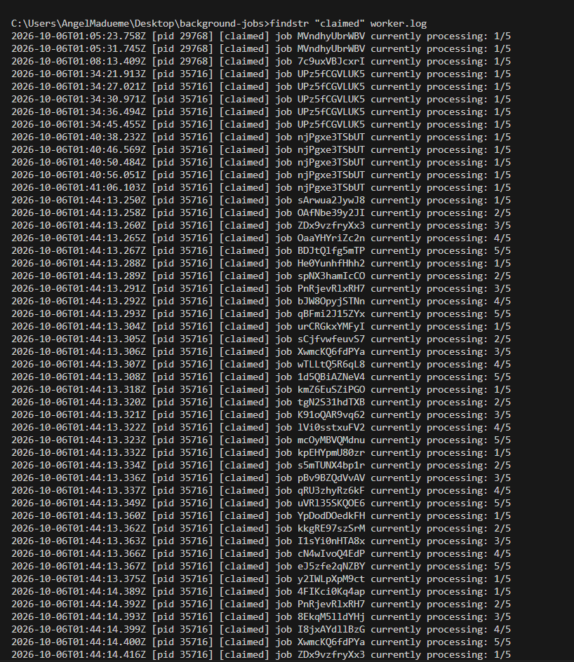

### Backoff and retry

I exercised a failing delivery and inspected the worker log. The retry entries show increasing scheduled delays with jitter, followed by the final dead state after the configured attempt limit.

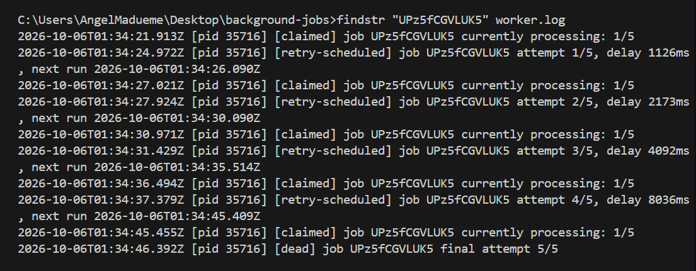

### Dead-letter state and counts

I let a job exhaust its attempts, then checked the stored row and the status counts. The row records the final attempt and error, while the application exposes it as a dead job.

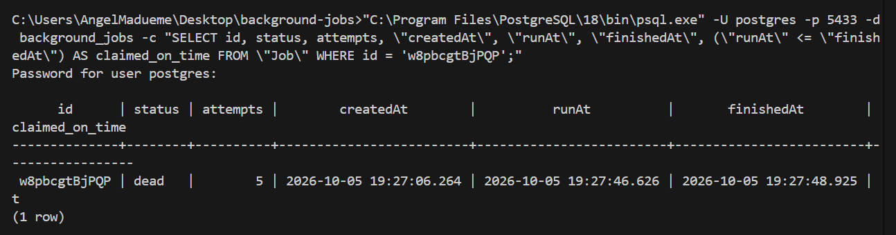

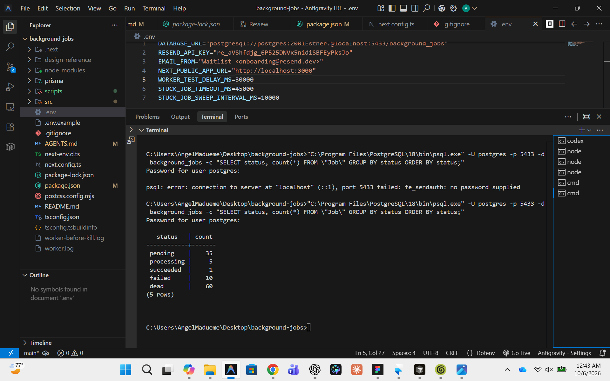

### Dead-letter view and retry

I opened the jobs screen with dead jobs present and inspected the dead-letter view. The evidence shows the dead-job presentation and the available retry action.

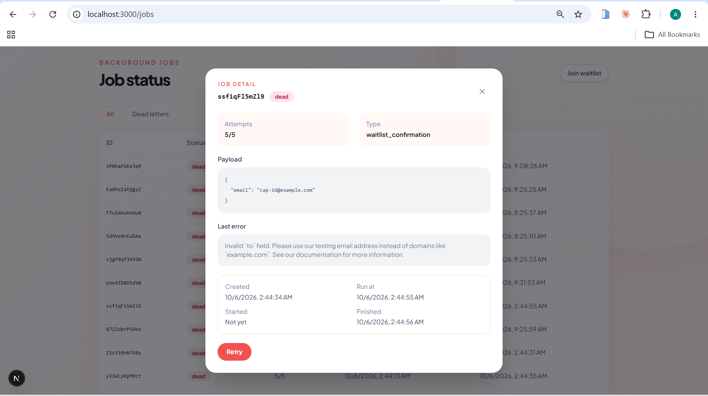

### Kill and sweep recovery

I started a job with the test delay, killed the worker while it was processing, waited for the sweep, and observed the job recover. The three screenshots show the stuck job, the sweep log, and the recovered result.

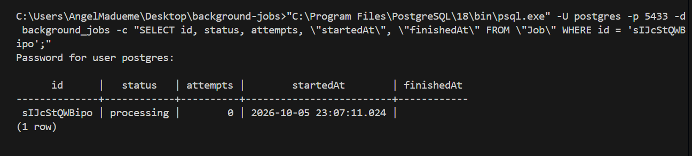

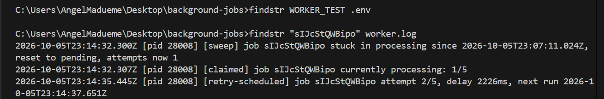

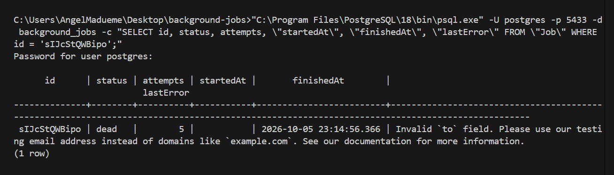

### Idempotent submission

I submitted the same email twice. The first request returned `202` and the second returned `200` for the existing job rather than creating a duplicate.

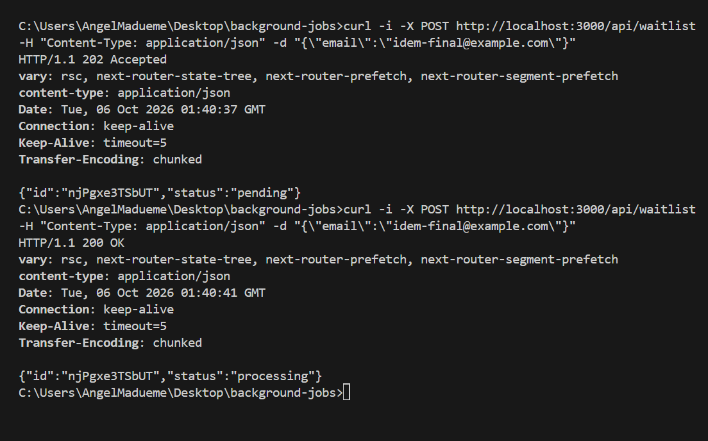

### Two workers racing

I ran two workers against the same queue and compared their logs and attempt counts. The evidence shows the workers sharing work without both claiming the same row, and the resulting attempts remain visible.

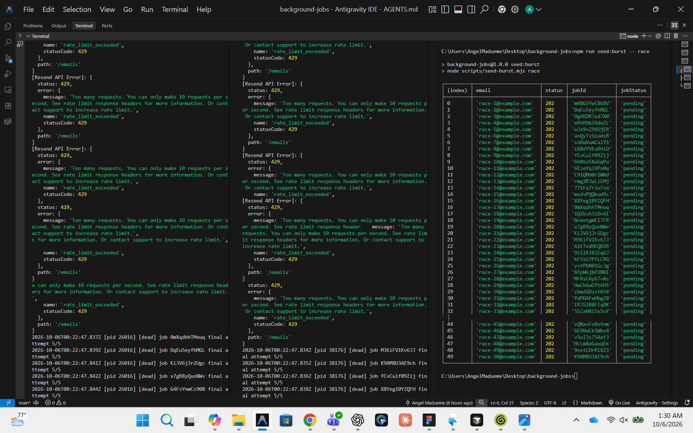

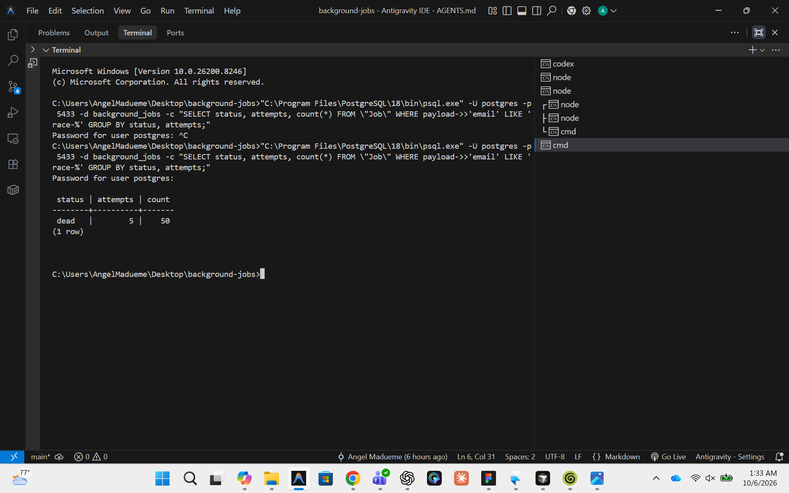

## Dead-letter view

The `/jobs` screen has an all-jobs view and a `Dead letters` filter backed by `GET /api/jobs?status=dead`. Selecting a row opens its payload and `lastError` detail. The `Retry` button is rendered only when the selected job is dead; it calls `POST /api/jobs/:id/retry`, which resets that job to pending for immediate processing. These behaviors are implemented in `src/components/JobsTable.tsx` and the retry route.

## What went wrong

- Resend only delivers to the account owner's address on an unverified account and rejects `example.com`, so most test jobs died with real `403` and `422` errors.
- Resend rate-limited at 10 requests a second under the burst, which is why the concurrency cap exists.
- A network outage produced `Unable to fetch data` errors; the retry path handled those failures.
- A timezone bug occurred because PostgreSQL runs in Lagos time while Prisma stores UTC wall-clock values. Comparing `runAt` to `NOW()` made retries run up to an hour early. I found it by seeing `runAt` later than `finishedAt` in dead jobs. The claim now compares against `(NOW() AT TIME ZONE 'UTC')`, checked with `npm run check:claim-tz`.

## Limitations

- The sweep lives in the worker, so a stuck job waits until a worker starts.
- The Resend free tier limits delivery to one address.
- Jobs have no history table; only the latest attempt state and error are stored.
